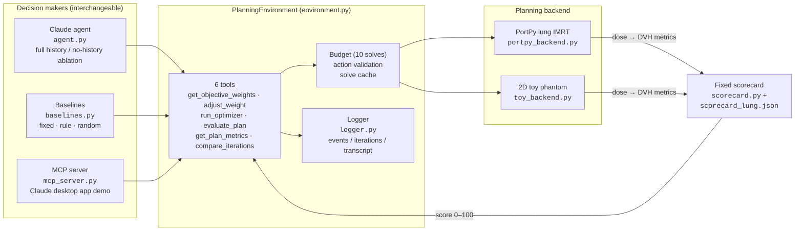
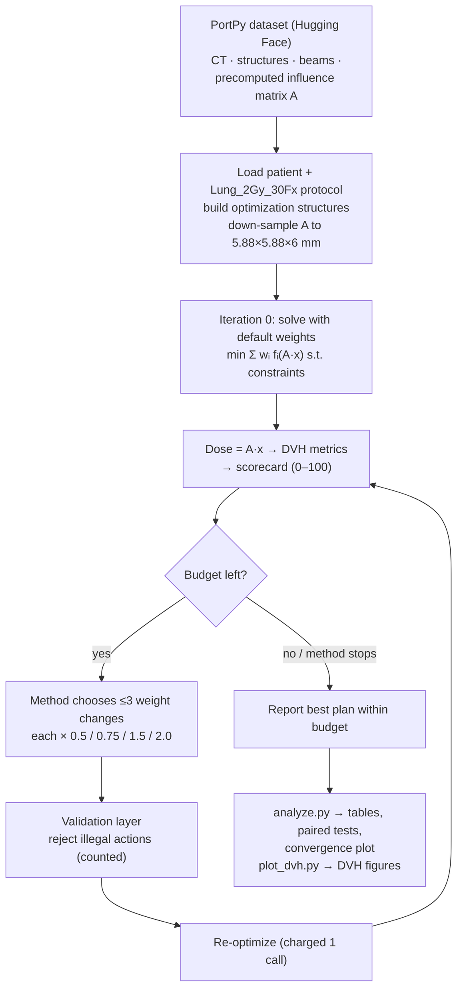
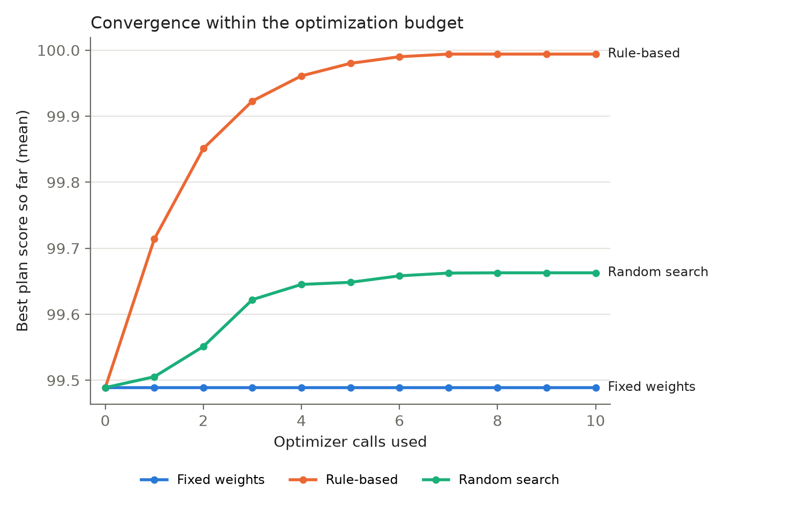
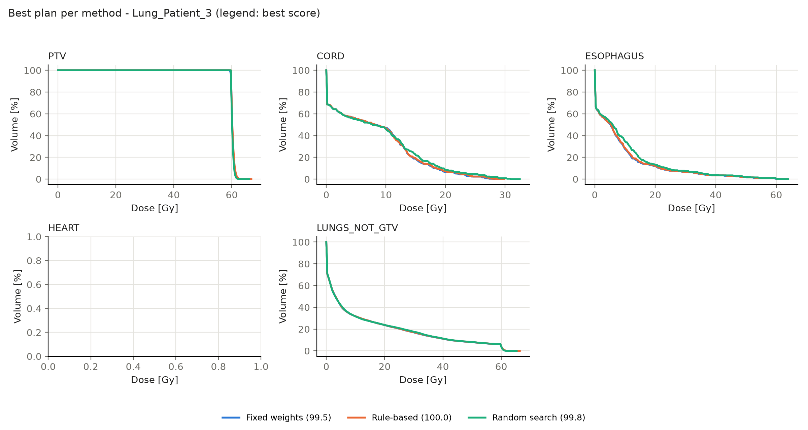

# rt_agent: LLM-guided objective weight tuning for lung IMRT

Research code for *An LLM-Based Agentic Framework for Autonomous Objective Weight
Tuning in Radiotherapy Treatment Planning*.

> **Computational research only. Not for clinical use.**

In inverse planning, a treatment plan comes from minimizing a weighted sum of
objectives (PTV coverage, cord sparing, lung sparing, …). Choosing those weights
is the manual, trial-and-error part of a planner's job. This project gives a
Claude agent the same small set of tools a planner uses (inspect the plan, change
a weight, re-optimize, compare) and asks whether it tunes weights better than
simple baselines **under the same fixed optimizer budget**.

---

## 1. Overall architecture



Everything that must be identical across methods (starting weights, admissible
actions, budget, solver, evaluation) lives in `PlanningEnvironment`. The LLM, the
baselines and the desktop-app demo all call the **same six tools** under the
**same rules**, so they can be compared fairly.

## 2. Pipeline



### Step by step

1. **Data.** `PortPyBackend` loads a patient from the
   [PortPy dataset](https://huggingface.co/datasets/PortPy-Project/PortPy_Dataset)
   (downloaded automatically into `data/`). The patient folder holds:

   | File | Contents |
   |---|---|
   | `CT_Data.h5`, `CT_MetaData.json` | Planning CT |
   | `StructureSet_Data.h5`, `StructureSet_MetaData.json` | Contours (PTV, CORD, ESOPHAGUS, HEART, LUNGs, …) |
   | `OptimizationVoxels_Data.h5`, `…_MetaData.json` | CT → dose-voxel map and dose grid |
   | `PlannerBeams.json` | Beams used (7 coplanar 6 MV fields for Lung_Patient_3) |
   | `Beams/Beam_<id>_Data.h5`, `…_MetaData.json` | Beam geometry, beamlets and the **precomputed dose influence matrix** |

   There is no dose engine in this repo. Dose is always `d = A · x`, where `A`
   (dose voxels × beamlets) is read from the dataset and `x` is the beamlet
   intensities the optimizer solves for.

2. **Optimization problem.** The `Lung_2Gy_30Fx` protocol (60 Gy in 30 fractions)
   defines 15 objectives (PTV over/underdose, cord, esophagus, heart, lungs, rind
   rings, smoothness) and hard constraints. The convex problem is built with
   PortPy and solved with CVXPY (SCS by default; MOSEK or CLARABEL are optional).

3. **Action space.** A method can multiply any tunable objective weight by
   0.5, 0.75, 1.5 or 2.0, with at most 3 changes per re-optimization. Weights stay
   within [w₀/100, 100·w₀]. The smoothness term and all constraints are fixed.

4. **Budget.** 10 `run_optimizer` calls. Iteration 0 (default weights) is free.

5. **Evaluation.** An independent, frozen scorecard
   ([`config/scorecard_lung.json`](config/scorecard_lung.json)) scores every plan.
   Each criterion gets 1.0 at its goal, 0.5 at its clinical limit, and 0 at
   twice the distance from goal to limit. The plan score is a priority-weighted mean
   × 100.

   | Criterion | Goal | Limit | Priority |
   |---|---|---|---|
   | PTV D95 | ≥ 60 Gy | ≥ 57 Gy | 3 |
   | PTV Dmax | ≤ 66 Gy | ≤ 69 Gy | 2 |
   | Cord Dmax | ≤ 45 Gy | ≤ 50 Gy | 3 |
   | Esophagus Dmean | ≤ 25 Gy | ≤ 34 Gy | 1 |
   | Heart Dmean | ≤ 15 Gy | ≤ 26 Gy | 1 |
   | Lungs V20 | ≤ 25 % | ≤ 37 % | 2 |
   | Lungs Dmean | ≤ 13 Gy | ≤ 20 Gy | 2 |

6. **Methods compared.**

   | Method | Description |
   |---|---|
   | `fixed` | Default-weight plan (iteration 0) |
   | `rule` | Deterministic: worst-scoring criterion → raise the matching objective's weight |
   | `random` | Random admissible adjustments (1–3 per call) |
   | `llm` | Claude agent with full conversation history and `compare_iterations` |
   | `llm_no_history` | Ablation: context reset after every optimizer call |

7. **Logging and analysis.** Every tool call goes to `events.jsonl`, every plan to
   `iterations.jsonl`, and every LLM message to `transcript.json`. `analyze.py`
   produces summary tables, paired tests and convergence plots. `plot_dvh.py`
   draws DVHs of each method's best plan.

## 3. Example patient: Lung_Patient_3

A real lung patient from the PortPy dataset: 60 Gy / 30 fx, 7 beams,
SCS solver, about 16 s per solve on the down-sampled grid (18k × 2.5k influence matrix).
Results are in [`results/portpy_v1/`](results/portpy_v1).

### Scores

| Method | Best score | Criteria passed | Optimizer calls | Solver time |
|---|---|---|---|---|
| Fixed weights | 99.49 | 7 / 7 | 0 | – |
| Rule-based | **99.99** | 7 / 7 | 7 | 108 s |
| Random search (5 repeats) | 99.66 ± 0.13 | 7 / 7 | 10 | 149 ± 9 s |
| LLM / LLM no-history | *not run yet (needs `ANTHROPIC_API_KEY`)* | | | |

### Dose metrics of each method's best plan

| Metric | Fixed | Rule-based | Random (rep 0) | Limit |
|---|---|---|---|---|
| PTV D95 [Gy] | 59.86 | 60.00 | 59.94 | ≥ 57 |
| PTV Dmax [Gy] | 63.28 | 63.58 | 62.83 | ≤ 69 |
| Cord Dmax [Gy] | 28.00 | 28.44 | 30.92 | ≤ 50 |
| Esophagus Dmean [Gy] | 4.35 | 4.44 | 4.99 | ≤ 34 |
| Heart Dmean [Gy] | 0.00 | 0.00 | 0.00 | ≤ 26 |
| Lungs V20 [%] | 11.55 | 11.57 | 11.61 | ≤ 37 |
| Lungs Dmean [Gy] | 5.94 | 5.96 | 6.00 | ≤ 20 |

### Convergence within the budget



### DVHs of the best plan per method



### Interpretation

- **The default plan is already clinically acceptable.** It passes all 7
  criteria and scores 99.5 / 100. The only criterion below its goal is PTV D95
  (59.86 vs 60 Gy).
- **Rule-based tuning closes that gap.** It raised the PTV underdose weight
  stepwise (10⁵ → 10⁷), bringing D95 to 60.0 Gy. The cost was a small increase
  in cord and esophagus dose, which the scorecard doesn't penalize because both
  are far below their goals. It stopped after 7 calls when no criterion was
  left to fix.
- **Random search** improves less and inconsistently (99.49–99.78). It often
  trades away OAR sparing (for example, cord Dmax rises to 30.9 Gy).
- **The DVH curves almost overlap.** On this patient, all methods produce
  practically equivalent plans.
- **Ceiling effect.** With about 0.5 points of headroom, this scorecard can't
  separate the methods on this patient. Before the LLM experiments, the scorecard
  goals should be tightened (OAR goals closer to what is achievable), or the
  search should start from a deliberately degraded plan, or the cohort should
  include harder cases.
- **Heart.** The heart gets 0 Gy on this patient, so `HEART_Dmean` passes
  trivially and its DVH panel is empty. It is most likely outside the treated region.

## 4. Repository layout

```
rt_agent/
├── rt_agent/
│   ├── environment.py        # budget, validation, solve cache, the six tools
│   ├── scorecard.py          # piecewise-linear plan-quality score
│   ├── agent.py              # Claude API agent loop (memory="full" | "none")
│   ├── baselines.py          # fixed, rule-based, random search
│   ├── mcp_server.py         # same tools exposed to the Claude desktop app
│   ├── logger.py, config.py, tools.py
│   └── backends/
│       ├── base.py           # PlanningBackend interface + DVH helper
│       ├── portpy_backend.py # the only file that touches PortPy
│       └── toy_backend.py    # 2D phantom with a synthetic influence matrix
├── config/
│   ├── experiment.json       # toy experiment
│   ├── portpy_lung.json      # real PortPy experiment
│   ├── scorecard_lung.json   # frozen evaluation criteria
│   └── claude_desktop_config.example.json
├── scripts/
│   ├── validate_environment.py
│   ├── run_experiment.py
│   ├── analyze.py
│   └── plot_dvh.py
├── tests/mock_client.py      # fake Claude client for offline tests
└── results/                  # experiment outputs (portpy_v1 = example above)
```

## 5. Quick start

```bash
python -m venv .venv
source .venv/bin/activate
pip install -r requirements.txt
```

**Toy backend** (no PortPy, no API key, runs in seconds):

```bash
python scripts/validate_environment.py
python scripts/run_experiment.py --methods fixed,rule,random
python scripts/run_experiment.py --mock --out results/mock_test   # tests the LLM loop offline
```

**PortPy (real patient).** This downloads `Lung_Patient_3` (~2 GB) on first run:

```bash
python scripts/validate_environment.py --config config/portpy_lung.json
python scripts/run_experiment.py --config config/portpy_lung.json --methods fixed,rule,random --out results/portpy_v1
python scripts/analyze.py results/portpy_v1
python scripts/plot_dvh.py results/portpy_v1 --patient Lung_Patient_3
```

**LLM methods.** These need an Anthropic API key, billed separately from a Claude.ai subscription:

```bash
export ANTHROPIC_API_KEY=...
python scripts/run_experiment.py --config config/portpy_lung.json --out results/portpy_v1
```

Finished runs are skipped on re-run, so you can add the LLM methods to an
existing results folder. Add `--no-cache` for final timing runs.

**Solver.** SCS is the default (free, about 6–16 s per solve here). MOSEK is
faster but needs a free academic license. CLARABEL also works.

**Claude desktop app demo.** Add the block in
`config/claude_desktop_config.example.json` (with your absolute paths) to the
app's MCP config. The `rt-planner` tools then appear in chat.

## 6. Reproducibility notes

- Model name, temperature, system prompt (`agent.SYSTEM_PROMPT`), config and
  scorecard are saved with every experiment (`config_used.json`).
- Invalid tool calls are rejected without changing state, and they are counted
  as a measure of decision consistency.
- With fewer than 6 patients, the Wilcoxon signed-rank test can't reach
  p < 0.05. In that case `analyze.py` reports per-patient wins and effect sizes.
- PortPy 1.2.0 needed two compatibility workarounds (see `portpy_backend.py`).
  Influence-matrix down-sampling is applied after construction.

## Acknowledgements

Planning data and optimization tools:
[PortPy](https://github.com/PortPy-Project/PortPy) (Memorial Sloan Kettering).
